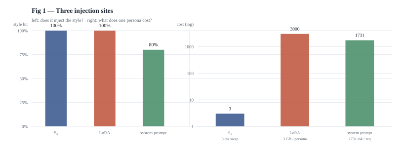
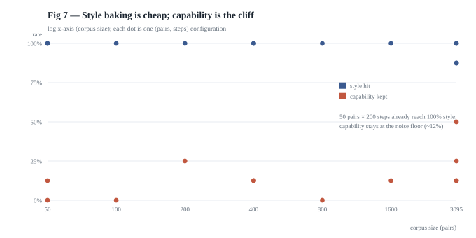
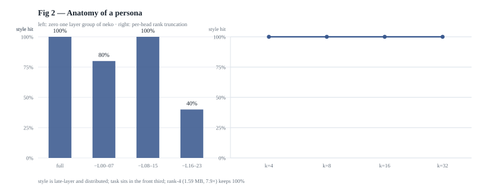
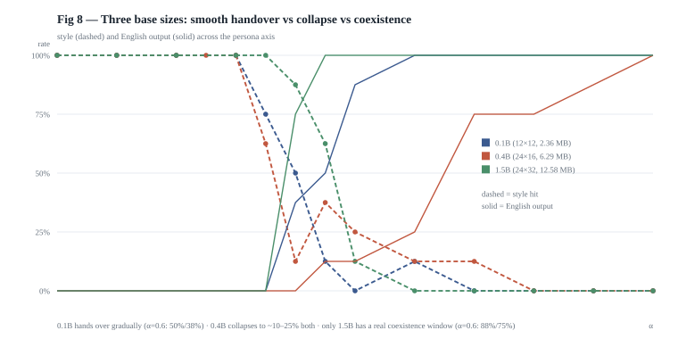
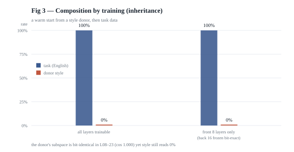
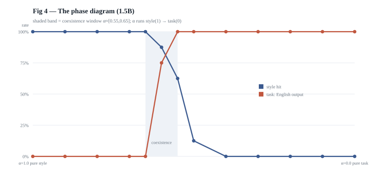
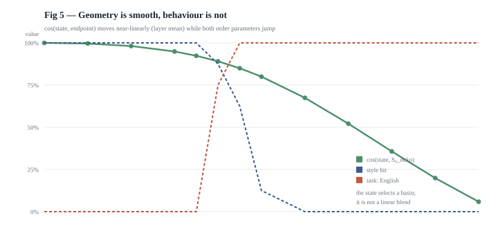
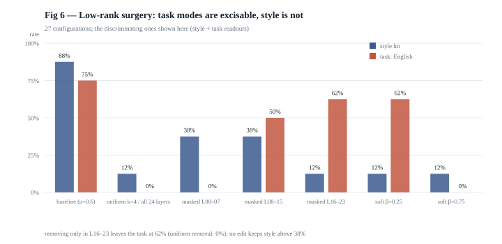

# The Geometry of RWKV Initial States: Persona Tuning, Phase Transitions, and Low-Rank Surgery

**Technical report — draft v0.1** · stateswap @ commit `HEAD` · all numbers reproducible from `docs/*.json` via the scripts in `scripts/`

---

## Abstract

We treat the RWKV-7 initial recurrent state S₀ — one 64×64 matrix per head per layer, ≈12.6 MB at the 1.5B scale — as the *sole trainable parameter* of a fully frozen base model, and study through six controlled experiments what it can and cannot do. Style and task modes bake perfectly (catgirl-style hit rate 12%→100%; unprompted zh→en translation 100% English output), while factual knowledge does not (≤13% recall regardless of corpus size; RAG-oracle 98%): **S₀ is a behavior prior, not a knowledge store**. Layer-group ablation locates task modes in the front third of layers and style in a distributed, late-layer-weighted subspace; per-head SVD shows a persona needs only ≈3–4 dimensions per head behaviorally, though 90% of its Frobenius energy needs 14–20. Mixing two trained states along the persona axis yields a **two-transition phase diagram** — pure-style for α∈[0.65,1], pure-task for α∈[0,0.5], and a narrow coexistence window at α≈[0.55,0.65] — with per-prompt attractor selection at the boundaries and a striking geometry–behavior decoupling: endpoint cosine similarity moves near-linearly while behavior jumps twice. Composition by training (warm start from a style donor, then task data) produces the opposite failure: task 100%, donor style 0%, even when the back 16 layers are bit-frozen — behavioral mode is selected by the front layers regardless of preserved style content. Low-rank directional edits (subspace removal, targeted injection, 18 configurations) confirm the picture: edits navigate the phase diagram but cannot surgically decompose it — removal from either direction is a factory reset. A cross-scale check (0.1B / 0.4B / 1.5B, all personas retrained with the fixed pipeline) shows the mixing regime itself changes with state size: smooth handover, then a collapse where both capabilities vanish mid-axis, then a genuine coexistence window. We release **stateswap**, a serving stack built on these findings: O(1) session state (12.78 MB constant), ≈3 ms persona hot-swap, 6.29× batched multi-session decode, int8 (4×) and rank-4 (7.9×) persona compression, a card→corpus→gated-persona factory, and a zero-dependency WebUI with a live 24-layer state monitor.

---

## 1. Introduction

Injecting a behavior into a frozen large language model has three canonical injection sites, each with a different cost model: **weights** (LoRA — GBs per persona, training required), **context** (system prompts — zero training, per-request token cost), and — specific to recurrent architectures — the **initial state**. RWKV-7 maintains a per-layer, per-head matrix recurrence state S that evolves with every token; standard inference cold-starts it at zero. Nothing about the architecture requires zero: S₀ can be treated as an explicit, trainable, *swappable* tensor. This affordance has no Transformer analogue — a Transformer's "initial KV cache" is not an object one can hold, compress, or hand to another process.

We systematize this affordance. Our contributions:

1. **The first systematic capability map of S₀** — what bakes (style, task modes), what cannot (facts), and what deep injection costs in base-model capability (a three-way S₀/LoRA/prompt comparison).
2. **An anatomy of a persona**: layer-group ablation (task = front third, style = late-weighted distributed) and per-head SVD (persona ≈ 3–4 dims/head behaviorally).
3. **A phase diagram of the persona axis** between two trained states: 13-point sweep, coexistence window, per-prompt attractor selection, geometry–behavior decoupling.
4. **Interventional validation via low-rank surgery**: 18 edit configurations showing that edits navigate but cannot decompose the phase diagram.
5. **stateswap**, an open serving stack that turns these findings into product mechanics: O(1) sessions, ~3 ms hot-swap, batched decode, persona compression, a gated persona factory — and **MemoPet**, a spin-off whose pet "brain" is literally a persisted S₀ (save/fork/dream).
6. Two reproducible engine bugs with diagnostics (fla's fused-recurrent S₀ gradient drop; a byte-level tokenizer mask-boundary bug that silently destroys composability).

## 2. Background and Related Work

**RWKV-7 recurrence.** RWKV-7 "Goose" is a linear-complexity RNN family with matrix-valued states: each layer maintains H heads of 64×64 state matrices updated by a generalized delta rule with vector-valued gating and in-context learning rates. Training is parallel (chunked recurrence); inference is O(1) per token with constant memory. RWKV-7's state tracking recognizes all regular languages, exceeding what Transformers can do under standard complexity conjectures (TC⁰).

**State tuning lineage.** Preen demonstrated state tuning on Mac/MLX; RWKV-PEFT ships it officially; State Tuning (arXiv:2504.05097) uses state optimization for test-time scaling with an observer-distillation pipeline. Our setting is simpler: offline training of S₀ on small corpora, then serving.

**Merging and state mixing.** Task-vector arithmetic (model soups, mode connectivity) operates in weight space. State Soup (2406.08423) and Soupability (2505.24033) move mixing to the state level on Mamba, reporting *smooth* interpolation benefits for ICL skills. Our Study 5 finds the opposite qualitative behavior for RWKV-7 task/persona attractors — a two-transition phase diagram — and Study 3 traces an earlier "sharp transition" observation to a training-pipeline bug, not to the geometry.

**Model editing.** ROME/MEMIT edit MLP weights in Transformers; ROME-on-Mamba (2404.03646) locates and rank-one-edits factual associations in Mamba; DREAMSTATE (2601.19221) generates and edits RWKV states with conditional diffusion, explicitly flagging "RNN states as editable knowledge" as an open problem. Our Study 6 occupies the precise gap between them: *directed, training-free, rank-k subspace operators on a trained S₀*.

## 3. Experimental Setup

**Base model.** RWKV7-World-1.5B (bf16, fully frozen, 24 layers × 32 heads × 64×64 state; S₀ = 3,145,728 parameters ≈ 12.58 MB fp32). All experiments post-date a tokenization-boundary bug fix (the "boundary bug" paragraph in §6) unless stated — its effect on recall is itself a finding.

**Personas.** `neko-1.5b` (catgirl style; 3,095 QA pairs; style hit 100%) and `zh2en-1.5b` (unprompted zh→en translation; 7,369 WMT pairs; **100% English-output rate**, where the metric is CJK-free English generation — not a translation-quality score; see Limitations). Training: AdamW, peak lr 1e-4 cosine to 1e-5, cross-entropy on assistant spans only, fresh S₀ cold-start per sample.

**Protocol.** Greedy decoding (temperature 0) unless stated; fresh session per probe; bounded context replay disabled for probes (context_replay=0); style hit rate = marker presence (喵/主人/（/小鱼干…); translation rate = CJK-free English output; raw replies and per-layer statistics preserved as JSON artifacts (`docs/*.json`) alongside one-command probe scripts (`scripts/probe_*.py`). A degeneration guard (turn-start state snapshot + character 4-gram uniqueness check + rollback) prevents polluted generations from entering any measured state.

## 4. Study 1 — What S₀ Can Bake, and What It Cannot

*Fig 1 — three injection sites: style transfer (left) and cost per persona (right).*

**Style and task modes bake perfectly.** Style hit rate 12–25% (cold) → 88–100%; at 1.5B, 12%→100% with 4,000 steps. Unprompted translation reaches a 100% English-output rate on held-out bare Chinese sentences. Data scale is a hard requirement: 50 pairs of bare-format translation data reach zero training loss yet only *memorize* (any paraphrase fails); 7,369 pairs generalize to a 100% English-output rate — task invariance needs both the training distribution and the data mass.

**Facts do not bake.** A controlled synthetic-knowledge study (100/300/500 facts, up to 33 epochs, training loss ≈ 0) yields ≤13% recall, *decreasing* with corpus size, versus 98% for a RAG oracle over the same facts. General capability is partially retained (capital-of-France survives) but self-description collapses into attractor text. Conclusion: **S₀ is a behavior prior, not a knowledge store**.

*Fig 7 — style saturates quickly; retained capability is the real curve.*

**Three-way comparison (S₀ / LoRA / system prompt).** All three inject style (100%/100%/80% at LoRA's 4.5× parameter budget). But depth injection overrides base capability: "capital of France" is answered in catgirl cadence under S₀ and LoRA, while the system prompt preserves it verbatim. Serving economics differ by an order of magnitude per persona: S₀ **registration** (load from disk into the registry) 13.7 ms / 12.6 MB, versus **hot-swap** (rebuild a session's 24 layer states) 2.6–5.9 ms; LoRA one 3 GB model directory per persona; system prompt 1,731 tokens per request. (Registration and swapping are distinct operations and are reported separately; the abstract's "≈3 ms" is the swap.)

## 5. Study 2 — Anatomy of a Persona

*Fig 2 — layer-group ablation and per-head rank truncation.*

**Layer addresses.** Zeroing front-third layers (L00–07) kills translation outright (0%) but keeps 80% style; zeroing back-third (L16–23) costs 60% style; the middle 8 layers are dispensable for both. Task mode lives in the front third; style is late-layer-weighted and distributed — no single third suffices for it alone.

**Per-head dimensionality.** 90% of Frobenius energy needs rank 14–20, but *behavior* survives rank-3 truncation at 100% (style and translation): a persona needs only ≈3–4 dimensions per head. Most state mass is behaviorally inert, which also explains the attractor-like transitions of Study 5 — a persona is a handful of directions in state space, not a volume. Rank-4 factored personas ship as 12.58 MB → 1.59 MB artifacts, behaviorally lossless.

## 6. Study 3 — Composition by Arithmetic (Two Rounds)

**Round 1 (0.4B, buggy pipeline — protocol corrected).** Mixing S = α·S_neko + (1−α)·S_zh2en at α ∈ {1, 0.75, 0.5, 0.25, 0}. The original run (one session per probe class) reported a sharp transition between 0.75 and 0.5: pure style → pure translator, plus "un-addable" additive sums. Re-running with one fresh session per probe (protocol v2, same checkpoints) gives a different shape: **α=0.5 is a valley where both capabilities collapse simultaneously** — style 25% (2/8), English output 12% (1/8), with replies that paraphrase the user's sentence back in Chinese ("月亮又圆又亮。") instead of translating it. α=0.75 → 100%/0%; α=0.25 → 0%/88%; α=0 → 0%/100%. Mixed states at α=0.5 are neither style nor task. Additive sums remain un-addable (`S_neko+S_zh2en` → 38%/88%; `0.5·(A+B)` is the same ray as α=0.5 → 25%/12%).

**The boundary bug.** Round 1 personas were trained with a byte-level tokenizer mask misalignment: prompt+completion encoded as one string lets greedy BPE merge across the boundary while the mask boundary is computed from the separately-encoded prompt. Training loss reaches zero, but the model learns *fragment continuation* — verbatim recall 5%, paraphrase 0%. After the fix (segmented encoding; boundary tokens belong to the completion), recall improves 2.4× (5%→12%) and paraphrase 0%→12%. This is a real, independently reproducible pipeline defect; it does **not**, however, explain either round's interpolation geometry — protocol v2 re-runs of both rounds reproduce the same phase structure with the fixed checkpoints.

**Round 2 (1.5B, fixed pipeline — protocol corrected).** An earlier version of round 2 reported the global 50/50 mix holding both capabilities (style 100% + translation 100%) and inferred that the boundary fix restored composability. That measurement used **one long session per probe class**: the six style replies contained five verbatim copies of the first reply and the six translation replies were identical, i.e. the state was echoing the first answer rather than being re-probed. Re-running with **one fresh session per probe** (context_replay=0, protocol v2) yields: 50/50 → style 17% (1/6), English output 100%; front-12-neko → style 17%, English 100%; back-12-neko → 0%/67%; alternate → 0%/100%; S_neko − S_zh2en → 100%/0%. The single style hit is the *same* prompt ("早上好呀…") that is the sole hit at α=0.5 in the 8-probe phase-diagram sweep (12.5% = 1/8) — two scripts, two probe sets, same conclusion: **α=0.5 is outside the coexistence window and phases flicker per prompt**. The round-1 "sharp transition" was therefore not a bug artefact; the boundary fix improved persona quality and recall but did not change the phase structure.

**Methodological warning (two, not one).** (i) Any masked-prefix training on byte-level tokenizers must be boundary-audited. (ii) Any state-model probe must use a fresh session per item — one session per probe *class* measures the model's echo, not its behaviour; verbatim repetition across probes is the tell. Both rounds' conclusions in this draft are re-run under protocol v2.

**Scale changes the shape, not just the numbers.** We ran the same sweep at three base sizes, retraining every persona with the fixed pipeline so that the comparison is not confounded by the tokenizer bug or by undertraining (the archived 0.1B neko persona had been trained for 300 steps on a 200-pair smoke set and read 50% style; retrained, it reads 100%). The three tiers produce **three qualitatively different diagrams**:

| tier | state | best both-capability point | what happens mid-axis |
|---|---|---|---|
| 0.1B (12×12) | 2.36 MB | 50% style / 38% English at α=0.6 | **smooth handover**: style declines 100→75→50→12%, English rises 0→38→50→88%; the curves cross, no valley |
| 0.4B (24×16) | 6.29 MB | 38% / 12% at α=0.55 (and 100%/0% at the style end) | **collapse**: both capabilities sit at 12–25% across α∈[0.3,0.6] before one recovers |
| 1.5B (24×32) | 12.58 MB | 88% style / 75% English at α=0.6 | **coexistence window** α≈[0.55,0.65], with per-prompt phase selection |

So the relationship to state capacity is **not monotone**: the smallest tier mixes smoothly (a blend rather than an attractor competition — "50% style" means half the probes are styled and half are not, with English appearing on other probes), the middle tier is the worst of both (neither capability survives the transition), and the largest tier supports a genuine coexistence window. We report this as-is rather than fitting a trend line: with one persona pair per tier and 8+8 probes, a three-point non-monotone pattern is a phenomenon to characterise, not a scaling law to assert. The capacity hypothesis remains the most plausible account of *why 0.4B collapses* — it has enough state to hold two basins but not enough to keep them apart, so they annihilate — and of why this paper's phase-diagram studies are all at 1.5B; but "smaller state ⇒ less coexistence" is false at the 0.1B end, where the two behaviours do not compete as basins at all. Raw data: `docs/phase-transition-0.1b.json`, `docs/phase-transition-0.4b-v2.json`, `docs/phase-transition.json`; figure below.

*Fig 8 — the same axis at three base sizes: smooth handover (0.1B), collapse (0.4B), coexistence (1.5B).*

## 7. Study 4 — Composition by Training (Inheritance)

*Fig 3 — warm start: task learned, donor style never expressed.*

Warm start S₀ ← style donor, then train on task data:

- **Naive (all layers trainable), 2,000 steps:** task 100%, donor style 0% — every input, including chat, is translated. The task attractor captures all behavior.
- **Layer-masked (--train-layers 0:8; back 16 layers frozen bit-exact at donor values):** task 100%, style **0%**. The donor's style content survives perfectly in the state — per-layer cosine to the donor is 1.000 in L08–23 — yet is never expressed.

This upgrades the anatomy report's correlational claim ("front layers dominate expression") to a **causal manipulation**: preserving a behavior's layer address does not preserve the behavior, because *which mode is expressed is selected by the front layers*. Training-based composition is an incremental-learning mechanism (it writes new capability into specified layers), not a composition mechanism — arithmetic mixing (Study 3/5) remains the way to keep both.

## 8. Study 5 — The Phase Diagram

*Fig 4 — the 1.5B phase diagram; the shaded band is the coexistence window.*

A 13-point α sweep over the persona axis (fixed pipeline, 1.5B):

| phase | α range | style | task |
|---|---|---|---|
| pure style | [0.65, 1] | 100% | 0% |
| **coexistence** | [0.55, 0.65] | 87.5% (α=0.6) | 75% |
| pure task | (0, 0.5] | 0% at α≤0.55 except 12.5% at 0.5 | 100% |

The center α≈0.58 sits style-side of the window. **Per-prompt selection (E6)**: no reply is ever blended — each prompt flips the whole generation to one phase, with prompt-dependent thresholds near the boundaries, and base-model "other" leakage exactly at the edges. **Geometry–behavior decoupling**: endpoint cosine similarities move near-linearly in α while the behavior order parameter jumps twice — the state is a basin selector, and basins have walls. **Session locking**: the *first* exchange decides the phase at α=0.5 (12.5% fresh vs 100% in-session) — in-context evidence outcompetes the initial-state prior. Equilibrium hysteresis protocols failed for measurement reasons (blend-walk degeneration); fresh-session + depth-controlled history is the proposed protocol. Temperature robustness holds (T=0 vs 0.7 thresholds align).

*Fig 5 — geometry (green) moves near-linearly while both order parameters jump.*

**Against State Soup**: smooth interpolation benefits on Mamba ICL skills versus a two-transition diagram on RWKV-7 task/persona attractors. Ranked hypotheses: (a) ICL skill vectors vs. strong task attractors; (b) RWKV-7 delta-rule geometry vs. Mamba's; (c) endpoint orthogonality (per-layer cos 0.02–0.12, median ≈0.06) of our persona pair.

## 9. Study 6 — Low-Rank Surgery

*Fig 6 — the discriminating edit configurations.*

Operators on a trained S₀: `remove_subspace(s, ref, k)` = (I − UUᵀ) s (I − VVᵀ) with U/V from ref's per-head SVD (surgical excision of the components living in ref's top-k subspace); `inject(s, direction, λ, k)` = s + λ·rank-k(direction); `rank_k` truncation. 27 configurations against the coexistence mixture (18 in the original sweep, 9 in the layer-masked/soft extension):

- **Targeted injection (cos 0.92 to the target S₀, 0.99 to the base mixture) → full flip into that attractor** at both capability readouts.
- **Removal in either direction at k ≥ 2 → both capabilities collapse to the base model** (factory reset). At k=1 a residual 12.5% style / 25% task survives — the first singular direction alone does not carry the whole behaviour. The coexistence mixture is a measure-zero knife edge: touching either constituent's subspace destroys the balance.
- Scalar subtraction works when the goal is one-directional (S_neko − S_zh2en keeps style, kills translation).

**Pitfall**: a singular-value broadcasting bug (per-head SVD applied to the batched matrix) was caught by a reconstruction-equivalence test — geometric checks alone are insufficient; every edit must pass behavioral probes (§3 protocol), because geometry–behavior decoupling (Study 5) means small edits can flip modes.

**Layer-masked and soft removal (E7/E8, 9 more configurations).** Uniform removal erased both capabilities because it operates on all 24 layers, but Study 2 shows the capabilities have layer addresses. Restricting the removal to one 8-layer band, or scaling it down (β<1 instead of a hard projection), changes the picture — but only for the task direction:

| edit | style | task |
|---|---|---|
| baseline (un-edited α=0.6 mixture) | 88% | 75% |
| uniform removal, k=4 (all 24 layers) | 12% | 0% |
| masked to L00–07, k=4 | 38% | **0%** |
| masked to L08–15, k=4 | 38% | **50%** |
| masked to L16–23, k=4 | 12% | **62%** |
| soft removal, k=4, β=0.25 | 12% | **62%** |

1. **Task directions are locally excisable.** Removing only in L16–23 (the *style* address band) leaves the task at 62%, versus 0–25% for uniform removal; removing in L00–07 (the task's own address) kills it outright. This is the first training-free edit in our set that produces a *targeted* behavioural loss rather than a factory reset.
2. **Style is not locatable, so it is not excisable.** Every masked configuration leaves style at 12–38%, never near the 88% baseline. This matches Study 2's finding that style is distributed across layers with a late-layer peak: removing ref's top-k subspace from *any* single band degrades style globally.
3. **Soft removal has no sweet spot.** β=0.25 keeps the task at 62% while style falls to 12%; larger β drops both. There is no setting where both capabilities remain substantially intact — the optimistic "partial scale" hypothesis is falsified.

**Takeaway (revised)**: persona assets can be *navigated* (mixing, injection, warm start) and **task modes can be weakened surgically** (layer-masked or soft removal on their address), but **style cannot be decomposed or dimmed** by any training-free operator we tried: it is either fully present or falls by 50–76 points. Combined with Study 4, the asymmetry is: write capabilities in; remove task modes; style is all-or-nothing.

## 10. System — stateswap

A serving stack that operationalizes the findings:

- **Engine**: per-session persistent state (12.78 MB constant, vs. O(T) KV caches); ~3 ms persona hot-swap; batched multi-session decode (6.29× at B=8); degeneration guard (turn-start snapshot + 4-gram uniqueness + rollback, so poisoned generations never enter long-term state); bounded context replay (bridging the 1.5B fact-retention ceiling without breaking O(1)); **attractor seeding** (a hidden in-context persona exchange that locks a fresh session into its attractor — first-exchange phase selection, Study 5, turned into a product feature).
- **Compression**: int8 (4×) and rank-4 (7.9×) persona artifacts, behaviorally lossless.
- **Persona factory**: card → LLM-generated corpus → multi-turn S₀ training → evaluation gate (style hit rate + capability-retention probes + degeneration check) → live registration. A failed gate refuses registration.
- **Engineering notes** (full details in the repository): fla/Triton pitfalls on Windows + Blackwell (sm_120); the fused-recurrent path dropping S₀ gradients in eval mode (train-mode chunk path required); the mask-boundary bug of §6; a CI dependency-drift postmortem; SSE-abort lock semantics (cooperative cancel — a running sync generator cannot be closed from another thread).

**MemoPet** (spin-off): a virtual pet whose brain is a persisted S₀ — save/fork/dream/time-travel mechanics built directly on state persistence, demonstrating the "persona as an MB-scale asset" economics outside the chat frame.

## 11. Discussion

The six studies compose into one picture: **the initial state is a basin selector, not a content carrier.** Modes (style, task) bake and combine because they are attractor directions; facts do not bake because a 12.6 MB state cannot hold a knowledge base; removal fails because deleting a direction collapses the basin balance rather than excising a behavior; the front layers select which basin is expressed regardless of what content survives elsewhere.

Implications: (i) the mixing regime is a capacity effect but not a monotone one — 0.1B blends smoothly, 0.4B collapses mid-axis, 1.5B supports a coexistence window, so personas-per-state budgets should be derived from state width and validated per tier rather than extrapolated from parameter count; (ii) recurrent-model behavior editing should target *basin selection* (injection, gating, seeding), not content excision; (iii) persona-as-asset economics are real — MB-scale, hot-swappable, compressible, forkable; (iv) RWKV-8's "mixed/smaller state" roadmap should account for phase structure — smaller states must preserve the basin geometry that makes personas possible, and our cross-scale sweep is a warning: shrinking the state can turn a coexistence window into a collapse, and shrinking it further turns the competition into a plain blend.

## 12. Limitations

**The engine itself is a confound.** All measurements run through flash-linear-attention 0.5.2, whose RWKV-7 implementation its own maintainers (and BlinkDL) describe as *not aligned with the reference implementation*; we measured a max |Δlogit| of 0.25 and mean 0.047 between its prefill (`chunk_rwkv7`) and decode (`fused_mul_recurrent`) paths on the same prompt and state, and the decode path's candidate distribution is visibly worse (U+FFFD and katakana entering the top-8). Cross-tier comparisons in this paper are internally consistent (every tier uses the same engine), but absolute capability numbers would likely improve under the official kernels. See engineering-notes §4.1b. Single persona pair (neko × zh2en) on a single base (1.5B); single-seed runs; heuristic metrics (marker/substring matching) rather than human evaluation — in particular the "English-output rate" measures language, not translation fidelity (a fluent off-topic English reply counts as a hit; see §6 round 2, `front_neko`); no Mamba control for the phase diagram; equilibrium hysteresis unmeasured (protocol in §8); editing studied only against the coexistence mixture.

## 13. Related Work (full)

State Soup [2406.08423]; Soupability [2505.24033]; ROME-on-Mamba [2404.03646]; DREAMSTATE [2601.19221]; State Tuning on RWKV-7 [2504.05097]; TTT layers; Dynamic Evaluation (Krause 2018); When Scaling Meets Finetuning [ICLR 2024]; model soups and task vectors; mode connectivity; RWKV-7 "Goose" [2503.14456]; Mamba-2; HART [2610.12883] (placeholder idling decay in RWKV states); SANE [2608.22354] (long-range state stability); WriteSAE [2605.12770] (rank-1 SAE atoms on RWKV-7 cache writes).

## 14. Reproducibility

Repository `stateswap` (GitHub, MIT): one-command probe per study (`scripts/probe_*.py`), raw JSON artifacts per study (`docs/*.json`, including the 0.4B contrast sweep `docs/phase-transition-0.4b.json`), trained personas committed (12.6 MB each, with int8/rank-4 variants), CI running the CPU test suite. Hardware for all results: one RTX 5070 Ti Laptop (12 GB), Windows 10, torch 2.11 cu128, fla 0.5.2. The companion repository `memopet` demonstrates the state-as-asset mechanics (persistence, forking, dreams) outside the chat frame.

---

*Draft status: v0.1 — all section content present, prose passes pending a technical edit; figures to be generated programmatically from `docs/*.json` per the figure table in `docs/paper-outline.md`.*
